# Fridler snapshots

Rendered by CI from ce747b397e02c3ded81d5ca79b97f4e585e7d679. Pictures with a reference in
`Snapshots/Reference` on `main` are checked against it on every build.

### v0.1-color-butter

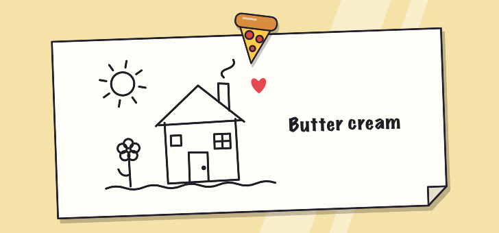

### v0.1-color-cherry

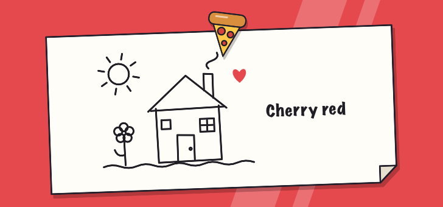

### v0.1-color-midnight

### v0.1-color-mint

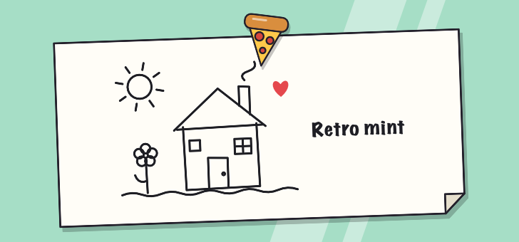

### v0.1-color-steel

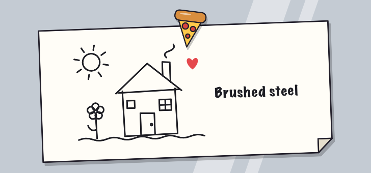

### v0.1-color-white

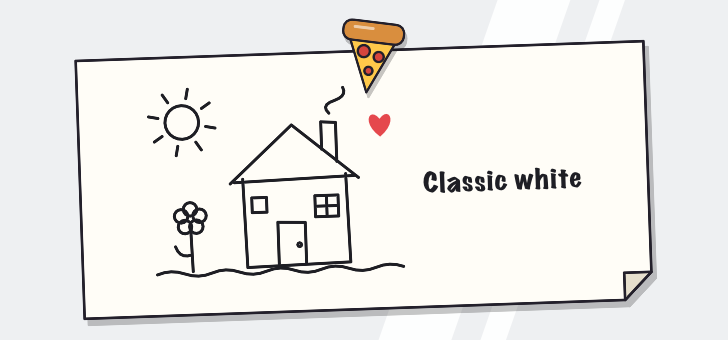

### v0.1-default-large

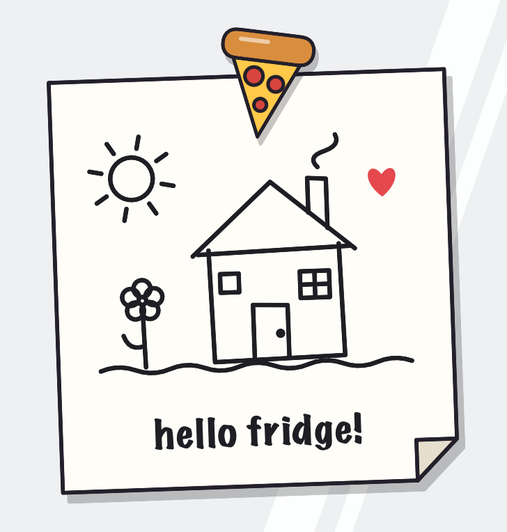

### v0.1-default-medium

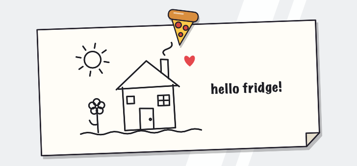

### v0.1-default-small

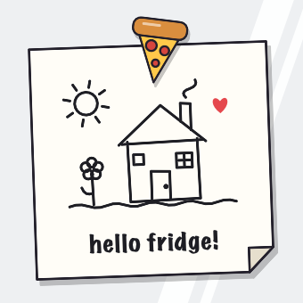

### v0.1-long-note-small

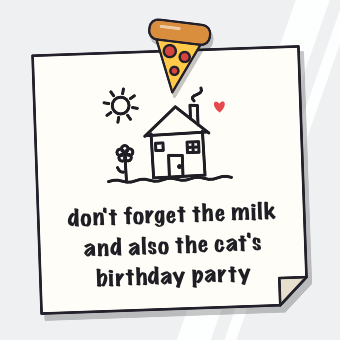

### v0.1-no-note-large

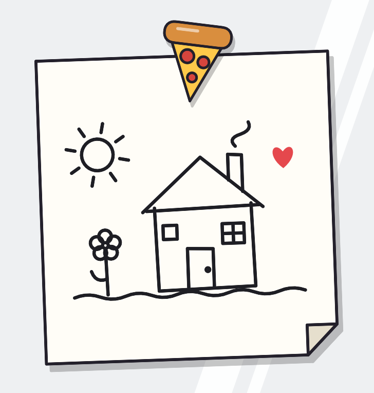

### v0.1-paper-on-glass-large

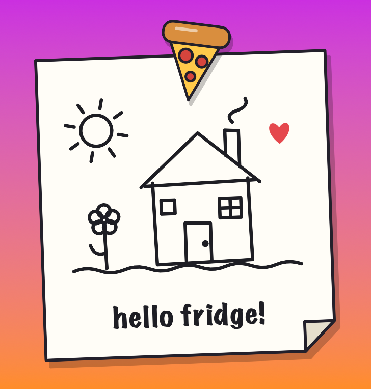

### v0.2-drawing-large

### v0.2-drawing-medium

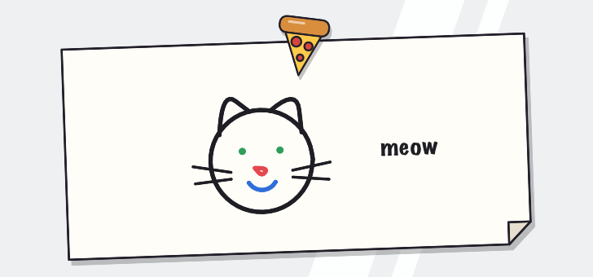

### v0.2-drawing-screen

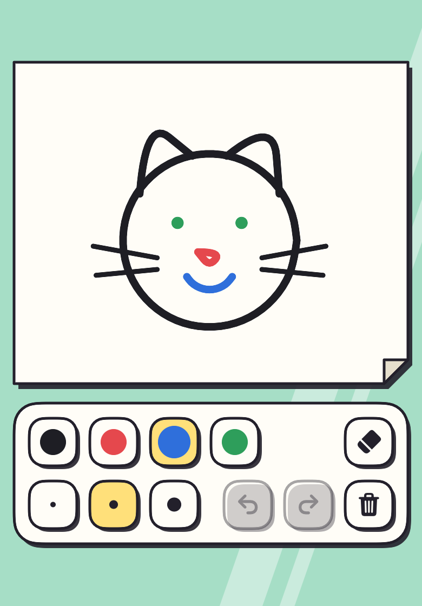

### v0.2-drawing-small

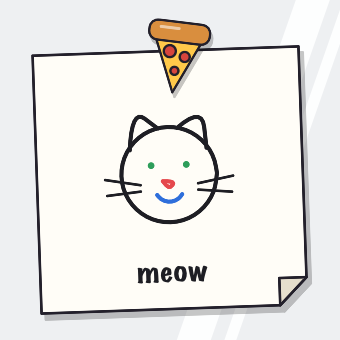

### v0.2-wiped-large

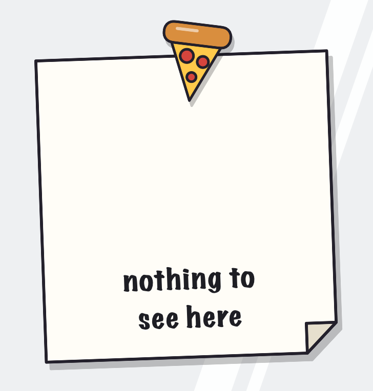

